<h1 align="center">Job Satisfaction &amp; Work-Life Balance</h1>

<p align="center">Survey analysis of job satisfaction and work-life balance among respondents in Bangalore, with R statistical tests and visualizations.</p>

<p align="center">
  <a href="src/job_satisfaction_analysis.R"></a>
  <a href="data/README.md"></a>
  <a href="#visualization-gallery"></a>
  <a href="summary/report.pdf"></a>
  <a href="LICENSE"></a>
</p>

## Overview

This Bangalore University M.A. Economics project examines job satisfaction,
remote work, well-being and work-life balance. The repository contains the
publication dataset, its codebook, the research report and a runnable R script.

The original study concerns Bangalore's IT sector, but source occupations include
non-IT roles. Results describe the observed sample; sector eligibility and the
sampling design are not independently verified.

**Key features:**

- 205 survey responses with 14 analysis fields and a response identifier
- 13 comparisons of survey responses across gender groups
- Counts, percentages, Pearson chi-square tests and Fisher tests
- Holm-adjusted Fisher p-values, expected-cell diagnostics and Cramer's V
- Binary proportion tests and conditional odds ratios where applicable
- 12 mosaic charts and one marital-status fourfold chart

## Requirements

- R, verified with version 4.5.3; no additional R packages are required
- An R build with Cairo support for PNG export
- The Liberation Serif system font

On Ubuntu or Debian, install the font with:

```sh
sudo apt-get install fonts-liberation2
```

## Quick Start

From the project root, run:

```sh
Rscript src/job_satisfaction_analysis.R
```

The script reads the CSV and codebook, prints statistical results, and exports
13 PNG charts to `plots/`. Each generated image is 2100 × 2100 pixels at 300 dpi.
To choose another output directory:

```sh
Rscript src/job_satisfaction_analysis.R /path/to/images
```

The dataset is resolved relative to the script, so the command also works from
other directories when the script path is supplied. To use another installed
font, set the `PLOT_FONT_FAMILY` environment variable before running the script.

Every plotted count is calculated from the CSV. Colours, titles and image settings
control presentation; the script contains no fixed report counts or reference
p-values.

## Findings

| Measure | Count | Percentage |
| --- | ---: | ---: |
| Weekly remote work under 10 hours | 114/205 | 55.6% |
| Positive reported remote-work productivity impact | 116/205 | 56.6% |
| Burnout or work-related illness | 48/205 | 23.4% |
| Current-job satisfaction at least 7/10 | 148/205 | 72.2% |

All 13 Pearson tests reproduce the report's displayed results. None of the
13 Fisher comparisons is significant after Holm adjustment. Non-significance
does not establish equality; observational results do not establish causation.

## Visualization Gallery

These are the original embedded plot images extracted from the report DOCX,
preserved at their original resolution. Select an image to view it at full size.
The R script produces new PNG exports in the separate `plots/` directory.

<p align="center">
  <a href="summary/plots/02_marital_status_and_gender.png">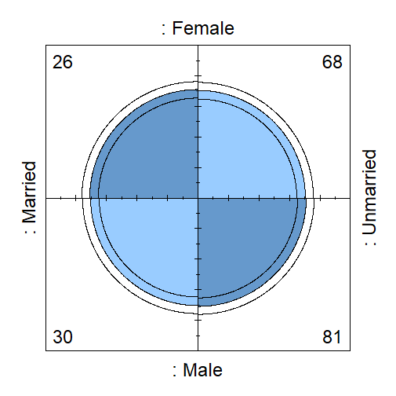</a>
  <br>Marital status
</p>

| <a href="summary/plots/01_work_experience_and_gender.png">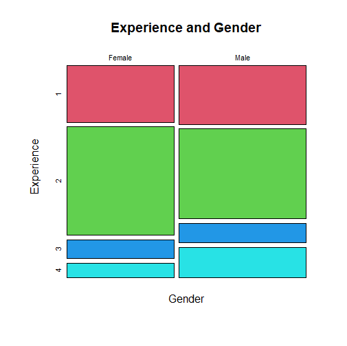</a> | <a href="summary/plots/03_remote_work_hours_and_gender.png">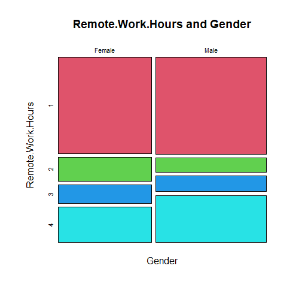</a> | <a href="summary/plots/04_remote_work_productivity_and_gender.png">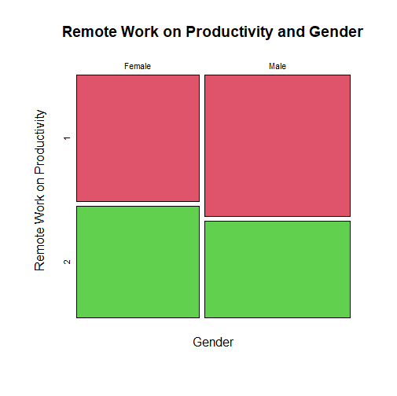</a> |
| :---: | :---: | :---: |
| Work experience | Remote work hours | Remote work productivity |

| <a href="summary/plots/05_work_related_illness_and_gender.png">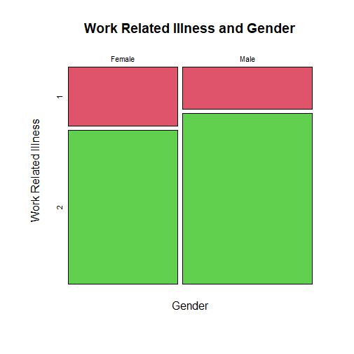</a> | <a href="summary/plots/06_physical_activity_and_gender.png">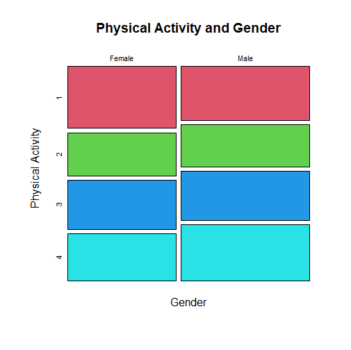</a> | <a href="summary/plots/07_stress_management_and_gender.png">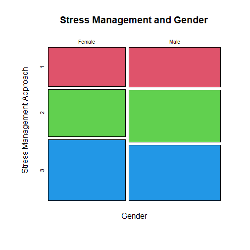</a> |
| :---: | :---: | :---: |
| Work-related illness | Physical activity | Stress management |

| <a href="summary/plots/08_professional_development_and_gender.png">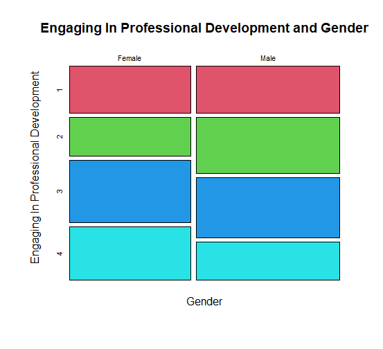</a> | <a href="summary/plots/09_difficulty_unplugging_from_technology_and_gender.png">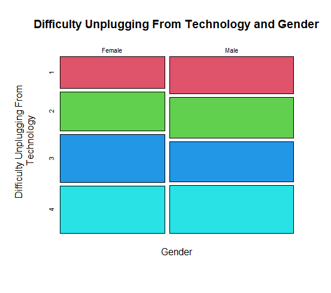</a> | <a href="summary/plots/10_declining_social_engagements_and_gender.png">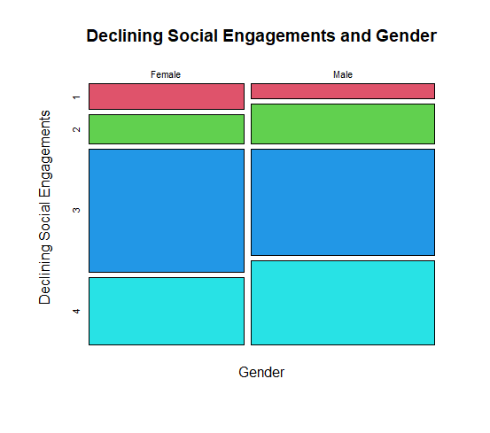</a> |
| :---: | :---: | :---: |
| Professional development | Unplugging from technology | Social engagements |

| <a href="summary/plots/11_dependent_care_support_satisfaction_and_gender.png">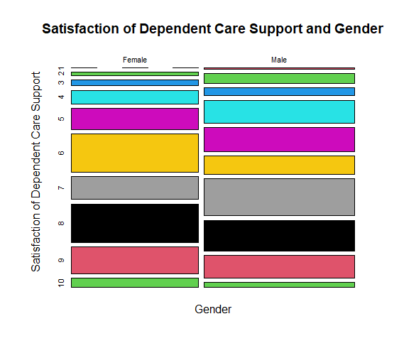</a> | <a href="summary/plots/12_current_job_satisfaction_and_gender.png">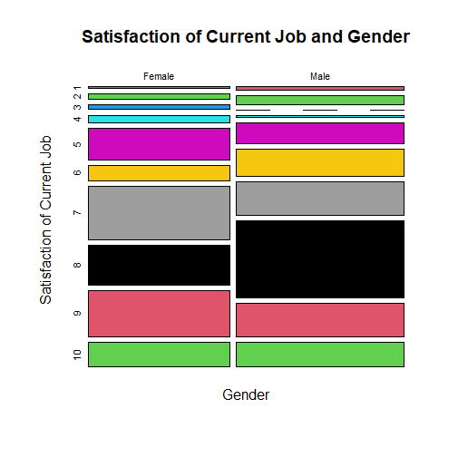</a> | <a href="summary/plots/13_job_dissatisfaction_aspects_and_gender.png">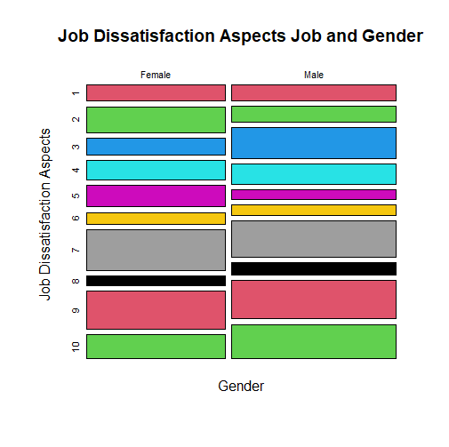</a> |
| :---: | :---: | :---: |
| Dependent care support satisfaction | Current job satisfaction | Job dissatisfaction aspects |

[Browse all report plots](summary/plots/) · [Read the full report](summary/report.pdf)

## Project Files

| Path | Purpose |
| --- | --- |
| [src/job_satisfaction_analysis.R](src/job_satisfaction_analysis.R) | Statistical analysis and PNG chart generation |
| [processed_data.csv](<data/processed data/processed_data.csv>) | 205 records: Respondent_ID plus 14 analysis fields |
| [data/README.md](data/README.md) | Dataset source, field descriptions and sample limitations |
| [data/codebook.csv](data/codebook.csv) | Category codes and labels |
| [summary/report.pdf](summary/report.pdf) | Full research report, including the current R code appendix |
| [summary/plots/](summary/plots/) | Original plot images extracted from the report |
| [reference/References.md](reference/References.md) | Study bibliography |

The editable `summary/report.docx` is kept locally and excluded from Git.
Regenerated charts in the root `plots/` directory are also excluded; the report
images in `summary/plots/` are included for the gallery.

## License and Data

The [MIT license](LICENSE) applies to project code. The publication dataset omits
names, ages and free-text job roles. See the [dataset documentation](data/README.md)
for its source and sample limitations. A separate dataset reuse license has not
been specified.
